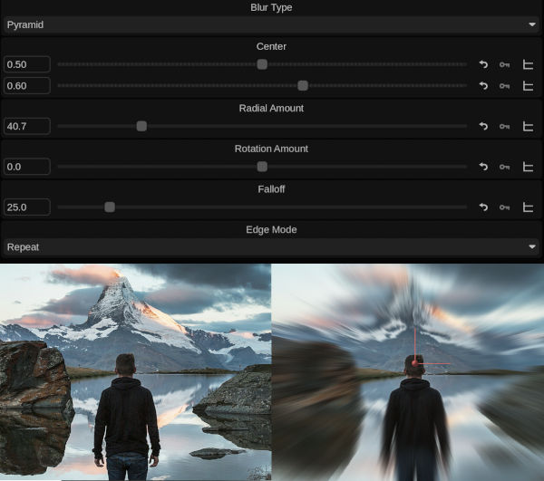

# Radial Blur

Blurs around a center point, simulating a zooming and/or rotating camera.

## Parameters

  - **Blur Type**: Box (simple but steppy), Pyramid (smooth and fast), or Gaussian (smoothest, uses most GPU resources)
  - **Center (X/Y)**: Moves the focal point of the blur
  - **Radial Amount**: Zoom blur amount (as a percent)
  - **Rotation Amount**: Optional spin blur amount (in degrees)
  - **Falloff**: Softness of the transition from unblurred centr to blurred area.
  - **Edge Mode**: How edges outside of frame are handled

## Installation

Unzip and place files into the */vol/.support/shaders* folder which is the same as
- **Linux:** /usr/fl/shaders
- **MacOS:** /Library/Application Support/FilmLight/shaders